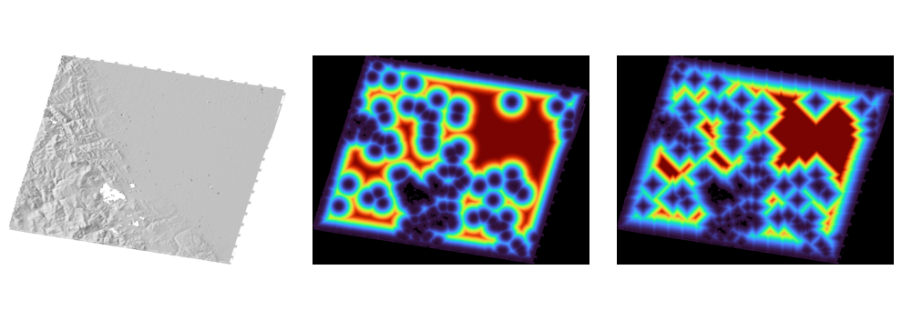

.. _dem_mosaic:

dem_mosaic
----------

The program ``dem_mosaic`` takes as input a list of DEM files and
creates a mosaic. By default, it seamlessly blends the DEMs where they
overlap. It can also combine the inputs in other ways.

See many examples in :numref:`dem_mosaic_examples`.

Overview
~~~~~~~~

The mosaic is written to the file passed to the ``-o`` option, for example
``-o mosaic.tif``. Normally the whole mosaic is this single file. A very large
mosaic can be written in tiles instead (:numref:`dem_mosaic_tiling`).

By default, the output mosaicked DEM will use the same grid size and
projection as the first input DEM. These can be changed via the ``--tr`` and
``--t_srs`` options. Also note the ``--gdal-tap`` and ``--tap`` options.

Blending happens only along a boundary where another DEM is present to
blend into. A boundary with no other DEM on the other side, such as the
outer edge of the data or a hole covered by no other DEM, stays sharp.

The default behavior is to blend the DEMs everywhere. This program
supports prioritizing one DEM (:numref:`dem_priority`).

Instead of blending, ``dem_mosaic`` can compute the image of first,
last, minimum, maximum, mean, standard deviation, median, and count of
all encountered valid DEM heights at output grid points. For the
"first" and "last" operations, the order in which DEMs were passed in
is used. With any of these options, the output name is adjusted
accordingly, and no blending happens, as specific input values are kept.

This tool can also apply hole-filling, smoothing, and pixel erosion at
boundary.

.. _dem_mosaic_blending_weights:

Blending weights
~~~~~~~~~~~~~~~~

To blend the DEMs, each DEM is given a weight that is largest in its interior
(with a plateau) and decays to zero at its boundary and around holes. The output
DEM is the weighted average, so every DEM fades out smoothly where it ends.

By default (as of build 2026/10, :numref:`release`) the blending weight is based
on the Euclidean distance to the boundary.

The option ``--grassfire-weights`` provides a weight that is based on the
Manhattan (grassfire) distance to the boundary. That weight has a diamond pattern
around holes and is not recommended.

   The blending weight for a DEM with many small holes. Left: the hillshaded DEM.
   Middle: the default Euclidean weight. Right: the grassfire weight.

.. _dem_mosaic_examples:

Examples
~~~~~~~~

Blend DEMs
^^^^^^^^^^

This creates a seamless DEM::

     dem_mosaic dem1.tif dem2.tif -o blended.tif

.. _dem_priority:

Priority blending
^^^^^^^^^^^^^^^^^

Read the DEMs from a list, and apply priority blending. The first DEM
in the list is given priority, with the others used as a background with this
transition length.

::

     echo dem1.tif dem2.tif > image_list.txt
     dem_mosaic -l image_list.txt --priority-blending-length 14 \
       -o priority_blended.tif

Mean height DEM
^^^^^^^^^^^^^^^

::

     dem_mosaic -l image_list.txt --mean -o mosaic.tif

This uses no blending. Also supported are the options ``--first``,
``--last``, ``--min``, ``--max``, ``--stddev``, ``--median``, ``--nmad``,
and ``--count``.

.. _dem_mosaic_external_weights:

External weights
^^^^^^^^^^^^^^^^

The default behavior of ``dem_mosaic`` is to blend the DEMs using a weighted
average with internal weights that decrease to zero towards the boundary of the
DEM and plateau inwards (:numref:`dem_mosaic_blending_weights`).

If, for example, the DEMs are known to have different vertical uncertainties
(:numref:`error_propagation`), these gridded uncertainties
(:numref:`export_stddev`) can be used as external weights. These weights can be
inverted (to ensure that a larger weight is given to a smaller vertical
uncertainty), then multiplied by the internal weights before blending.

A larger stereo convergence angle (:numref:`stereo_pairs`) results in less
vertical uncertainty.

Example::

    ls stereo_runs/*/run-DEM.tif              \
        > stereo_runs/dem_list.txt
    ls stereo_runs/*/run-VerticalStdDev.tif   \
        > stereo_runs/vert_list.txt

    dem_mosaic                                \
      --dem-list stereo_runs/dem_list.txt     \
      --weight-list stereo_runs/vert_list.txt \
      --invert-weights                        \
      -o stereo_runs/weighted_mosaic.tif

In addition to the option ``--invert-weights``, the option ``--min-weight`` can
help ensure that the weights are not too small (before being inverted).

The weights must be in one-to-one correspondence with the DEMs to be mosaicked.
Any weight value that equals the no-data value will be ignored.

Another candidate for the weight could be the triangulation error
(:numref:`point2dem_ortho_err`). The ``--min-weight`` option is strongly
encouraged in this case, as an extremely small triangulation error may not
suggest high reliability alone.

The ``image_calc`` program (:numref:`image_calc`) can help devise schemas for
how various uncertainty measures could be combined into a single weight image.

Regridding
^^^^^^^^^^

Enforce that the output pixel centers are at integer multiples of grid size::

    dem_mosaic --tr 0.10 --tap input.tif -o output.tif

If the bounds of the output DEM from above are examined with
``gdalinfo`` (:numref:`gdal_tools`), they will be multiples of 0.05,
because each grid point is centered at an integer multiple of 0.10,
and extends for half a grid vertically and horizontally.

(Note that ``point2dem`` (:numref:`point2dem`) and ``mapproject``
(:numref:`mapproject`) create their outputs by default that way, and
if ``dem_mosaic`` is invoked on such datasets, it will respect the
input grid even without ``--tap`` being explicitly set.)

See :numref:`gdal_tap` for when it is desired to emulate the GDAL
``-tap`` option.

.. _dem_mosaic_blur:

Apply a blur
^^^^^^^^^^^^

::

    dem_mosaic --dem-blur-sigma 1 input.tif -o output.tif

This option will also extend the DEM somewhat and fill some holes, especially
with a larger sigma.

Erosion
^^^^^^^

Erode 3 pixels at the boundary::

     dem_mosaic --erode-length 3 input.tif -o output.tif

.. _dem_mosaic_fill:

Fill small holes
^^^^^^^^^^^^^^^^

::

    dem_mosaic --hole-fill-length 50 input.tif -o output.tif

.. _dem_mosaic_extrapolate:

Extrapolating a DEM
^^^^^^^^^^^^^^^^^^^

To extrapolate a DEM based on a weighted average of neighbors, run::

    dem_mosaic                  \
        --fill-search-radius 25 \
        --fill-power 8          \
        --fill-percent 10       \
        --fill-num-passes 3     \
        input.tif -o filled.tif

This command will become very slow for large ``--fill-search-radius``.
It is suggested to increase ``--fill-num-passes`` instead.

This method will also grow the DEM outwards, not just within
a hole, unlike the hole-filling example in :numref:`dem_mosaic_fill`.

It is suggested to blur a little the obtained DEM, such as::

    dem_mosaic --dem-blur-sigma 2 filled.tif -o blurred.tif

To preserve as much as possible the input DEM values in the resulting DEM,
except a small transition area at the boundary, run::

    dem_mosaic --priority-blending-length 20 \
      input.tif blurred.tif -o output.tif

The extrapolation works as follows. For any pixel that is invalid (lacks data),
``dem_mosaic`` will search for valid pixels within the specified search radius.
If the percentage of valid to total number of found pixels is no less than the
specified value, the invalid pixel will be filled with the weighted average of
the valid pixel values, with the weight given as:

.. math::

    \frac{1}{d^p + 1}

where :math:`d` is the distance from the invalid to the valid pixel to borrow
the value from, and :math:`p` is given by ``--fill-power``.

This process will be repeated the specified number of times, with the valid
portion of the DEM growing each time.

.. _gdal_tap:

Target aligned pixels
^^^^^^^^^^^^^^^^^^^^^

A command such as::

  dem_mosaic --gdal-tap                       \
    --tr 1                                    \
    --t_projwin 641401 4120288 652701 4133728 \
    input.tif -o output.tif

should produce a DEM with the bounds and grid size specified above, with
bilinear interpolation. This is analogous to ``gdalwarp`` (:numref:`gdal_tools`)
with the options ``-tap -tr 1 1 -r bilinear -te``. Here, a projection in units
of meter is assumed.

Internal processing
~~~~~~~~~~~~~~~~~~~

The tool reads input DEMs as single precision (float32), performs all
processing in double precision (float64) for numerical accuracy, and
writes output mosaics as single precision (float32) by default. The output
type can be changed via the ``--ot`` option to Byte, UInt16, Int16, UInt32,
Int32, or Float32.

.. _dem_mosaic_tiling:

Very large mosaics
~~~~~~~~~~~~~~~~~~

Normally the whole mosaic is written as a single file, the ``-o`` file with a
``.tif`` extension. For a very large mosaic it can instead be written as
non-overlapping tiles. The tile size is set in pixels with ``--tile-size``, or
in georeferenced units with ``--georef-tile-size``. If a prefix is passed to
``-o``, without a ``.tif`` extension, the tiles are named::

    output_prefix-tile-0.tif

Individual tiles can be saved with the ``--tile-index`` option (the tool prints
the total number of tiles). Separate processes can then be run for individual
tiles, for robustness and speed.

If the number of input DEMs is very large, the tool can fail, as the operating
system may refuse to load all DEMs at once. Then, use ``--tile-size`` to break
the output into several large tiles, invoke the tool for each with
``--tile-index``, and later run ``dem_mosaic`` again to merge the tiles.

Usage
~~~~~

::

     dem_mosaic [options] <dem files> -o output.tif

or::

     dem_mosaic [options] -l dem_files_list.txt -o output.tif

Command-line options
~~~~~~~~~~~~~~~~~~~~

-l, --dem-list <string>
    A text file listing the DEM files to mosaic, one per line.

-o, --output-prefix <string>
    Specify the output prefix. One or more tiles will be written
    with this prefix. Alternatively, an exact output file can be
    specified, with a .tif extension.

--tile-size <integer (default: 1000000)>
    The maximum size of output DEM tile files to write, in pixels.

--tile-index <integer>
    The index of the tile to save (starting from zero). When this
    program is invoked, it will print out how many tiles are there.
    Default: save all tiles.

--tile-list <string>
    List of tile indices (in quotes) to save. A tile index starts
    from 0.

--priority-blending-length <integer (default: 0)>
    If positive, keep unmodified values from the earliest available
    DEM except a band this wide measured in pixels inward of its
    boundary where blending with subsequent DEMs will happen.

--tr <double>
    Output grid size, that is, the DEM resolution in target
    georeferenced units per pixel. Default: use the same resolution as
    the first DEM to be mosaicked.

--t_srs <string>
    Specify the output projection as a GDAL projection string (WKT, GeoJSON, or
    PROJ). If not provided, use the one from the first DEM to be mosaicked.

--t_projwin <double double double double>
    Limit the mosaic to this region, with the corners given in georeferenced
    coordinates (xmin ymin xmax ymax). Max is exclusive. See the ``--gdal-tap``
    and ``--tap`` options if desired to apply addition adjustments to this
    extent.

--first
    Keep the first encountered DEM value (in the input order).

--last
    Keep the last encountered DEM value (in the input order).

--min
    Keep the smallest encountered DEM value.

--max
    Keep the largest encountered DEM value.

--mean
    Find the mean DEM value.

--stddev
    Find the standard deviation of DEM values.

--median
    Find the median DEM value (this can be memory-intensive, fewer threads are suggested).

--nmad
    Find the normalized median absolute deviation DEM value (this
    can be memory-intensive, fewer threads are suggested).

--count
    Each pixel is set to the number of valid DEM heights at that pixel.

--hole-fill-length <integer (default: 0)>
    Maximum dimensions of a hole in the DEM to fill, in
    pixels. See also ``--fill-search-radius``.

--fill-search-radius <double (default: 0.0)>
    Fill an invalid pixel with a weighted average of pixel values within this
    radius in pixels. The weight is :math:`1/(d^p + 1)`, where the distance is
    measured in pixels. See an example in :numref:`dem_mosaic_examples`. See
    also ``--fill-power``, ``--fill-percent`` and ``--fill-num-passes``.

--fill-power <double (default: 8.0)>
    Power exponent to use when filling nodata values with
    ``--fill-search-radius``.

--fill-percent <double (default: 10.0)>
    Fill an invalid pixel using weighted values of neighbors only if
    the percentage of valid pixels within the radius given by
    ``--fill-search-radius`` is at least this.

--fill-num-passes <integer (default: 0)>
    Fill invalid values using ``--fill-search-radius`` this many times.

--erode-length <integer (default: 0)>
    Erode the DEM by this many pixels at boundary.

--weight-list <string (default: "")>
    A text file having a list of external weight files to use in blending, one
    per line. These are multiplied by the internal weights to ensure seamless
    blending. The weights must be in one-to-one correspondence with the DEMs to
    be mosaicked. See :numref:`dem_mosaic_external_weights`.

--invert-weights
    Use 1/weight instead of weight in blending, with ``--weight-list``.

--min-weight <double (default: 0.0)>
    Limit from below with this value the weights provided with ``--weight-list``.

--georef-tile-size <double>
    Set the tile size in georeferenced (projected) units (e.g.,
    degrees or meters).

--output-nodata-value <double>
    No-data value to use on output.  Default: use the one from the
    first DEM to be mosaicked.

--ot <string (default: Float32)>
    Output data type. Supported types: Byte, UInt16, Int16, UInt32,
    Int32, Float32. If the output type is a kind of integer, values
    are rounded and then clamped to the limits of that type.

--weights-blur-sigma <double (default: 5.0)>
    The standard deviation of the Gaussian used to blur the weights.
    Higher value results in smoother weights and blending.  Set to
    0 to not use blurring.

--weights-exponent <float (default: 2.0)>
    The weights used to blend the DEMs should increase away from
    the boundary as a power with this exponent. Higher values will
    result in smoother but faster-growing weights.

--use-centerline-weights
    Compute weights based on a DEM centerline algorithm. Produces
    smoother weights if the input DEMs don't have holes or complicated
    boundary.

--dem-blur-sigma <double (default: 0.0)>
    Blur the DEM using a Gaussian with this value of sigma.
    A larger value will blur more. Default: No blur.

--extra-crop-length <integer (default: 200)>
    Crop the DEMs this far from the current tile (measured in pixels) before
    blending them (a small value may result in artifacts). This value also helps
    determine how to plateau the blending weights inwards, away from the DEM
    boundary.

--nodata-threshold <float>
    Values no larger than this number will be interpreted as no-data.

--force-projwin
    Make the output mosaic fill precisely the specified projwin,
    by padding it if necessary and aligning the output grid to the
    region. This is the default with ``--gdal-tap --projwin``.

--gdal-tap
    Ensure that the bounds of output products (as printed by ``gdalinfo``,
    :numref:`gdal_tools`) are integer multiples of the grid size (as set with
    ``--tr``). When ``--t_projwin`` is set and its entries are integer multiples
    of the grid size, that precise extent will be produced on output. This
    functions as the GDAL ``-tap`` option. An example is in :numref:`gdal_tap`.

--tap
    Let the output grid be at integer multiples of the grid size (like
    the default behavior of ``point2dem`` and ``mapproject``, and
    ``gdalwarp`` when invoked with ``-tap``, though the latter does
    not have the half-a-pixel extra extent this tool has). If this
    option is not set, the input grids determine the output grid.
    See also ``--gdal-tap``.

--save-dem-weight <integer>
    Save the weight image that tracks how much the input DEM with
    given index contributed to the output mosaic at each pixel
    (smallest index is 0).

--save-index-map
    For each output pixel, save the index of the input DEM it came
    from (applicable only for ``--first``, ``--last``, ``--min``,
    ``--max``, ``--median``, and ``--nmad``). A text file with the
    index assigned to each input DEM is saved as well.

--threads <integer (default: 0)>
    Select the number of threads to use for each process. If 0, use
    the number of threads set in ~/.vwrc, or the number of cores if
    not set there (:numref:`vwrc`).

--tif-tile-size <integer (default: 256 256)>
    The dimensions of each block in the output image.

--cache-size-mb <integer (default = 1024)>
    Set the system cache size, in MB.

--no-bigtiff
    Tell GDAL to not create BigTiff files.

--tif-compress <None|LZW|Deflate|Packbits (default: LZW)>
    TIFF compression method.

--cog
    Write a cloud-optimized GeoTIFF (COG). See :numref:`cog_output`.

-v, --version
    Display the version of software.

-h, --help
    Display this help message.
